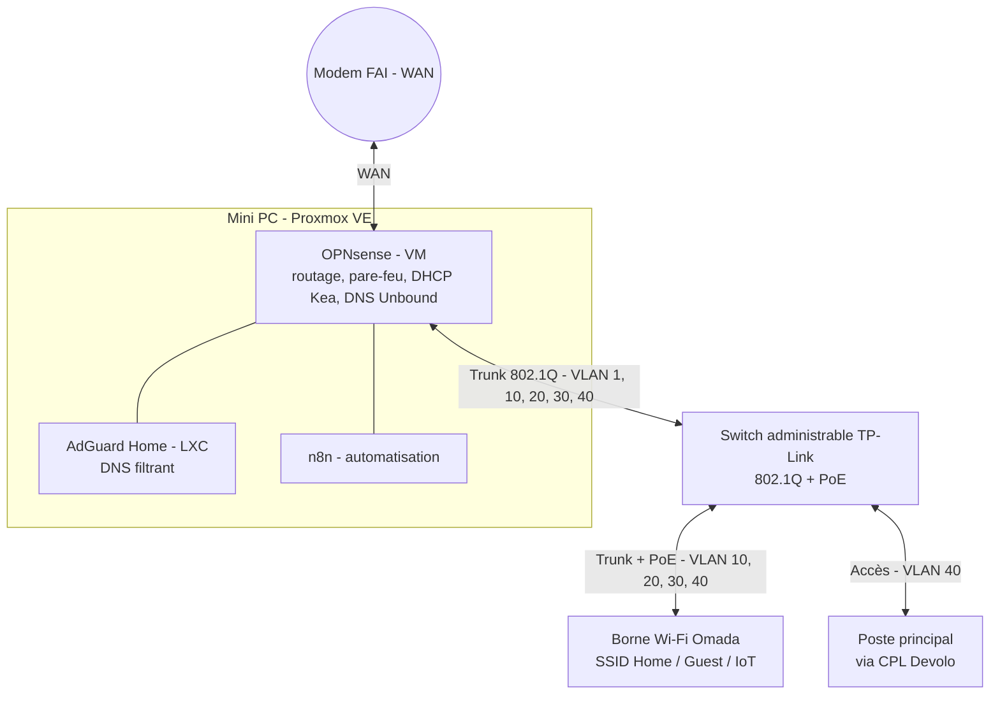

# Infrastructure réseau & virtualisation (Homelab)

**Objectif :** concevoir et administrer un réseau segmenté inspiré d'un réseau d'entreprise : pare-feu virtualisé, 5 réseaux séparés par VLAN, Wi-Fi multi-SSID, DNS filtrant et réseau d'administration isolé, en appliquant le principe du moindre privilège.



## 1. Plan d'adressage et rôle de chaque réseau

| VLAN | Réseau | Sous-réseau | Rôle | Accès autorisés |
|---|---|---|---|---|
| 1 (non tagué) | Serveurs | 192.168.1.0/24 | Services internes (DNS AdGuard, n8n) | Services joignables par les autres réseaux sur leurs ports dédiés |
| 10 | Administration | 192.168.10.0/24 | Interfaces de gestion : OPNsense, Proxmox, switch, borne (IP fixes, pas de DHCP) | Uniquement depuis le poste d'administration |
| 20 | IoT | 192.168.20.0/24 | Objets connectés | Internet uniquement |
| 30 | Invités | 192.168.30.0/24 | Wi-Fi invités, isolation client | Internet uniquement |
| 40 | Home | 192.168.40.0/24 | Appareils de confiance | Internet + DNS AdGuard ; administration réservée au poste admin |

## 2. Virtualisation (Proxmox VE)

- Proxmox VE installé en bare-metal sur un mini PC.
- **OPNsense** en machine virtuelle : routeur et pare-feu principal.
- **AdGuard Home** en conteneur LXC non privilégié.
- Pont WAN sans adresse IP pour l'hôte : Proxmox n'est joignable que depuis le VLAN d'administration.

## 3. Routage et sécurité (OPNsense)

- Routage inter-VLAN (router-on-a-stick), NAT et DHCP (Kea) par réseau.
- Pare-feu à état, règles par interface évaluées de haut en bas, blocage par défaut.
- Alias pour des règles lisibles (poste admin, ports d'administration, réseaux privés RFC 1918).
- **Home :** seul le poste d'administration (réservation DHCP) accède aux interfaces de gestion ; les autres appareils sont bloqués vers OPNsense et le VLAN admin.
- **Invités / IoT :** accès à tous les réseaux privés bloqué, Internet uniquement.
- Règle anti-blocage conservée sur le réseau serveurs comme accès de secours.

## 4. Commutation et Wi-Fi

| Port switch | Équipement | Configuration |
|---|---|---|
| 1 | Borne Omada (PoE) | Trunk : 20/30/40 tagués, VLAN 10 non tagué (gestion de la borne) |
| 3 | CPL Devolo → poste | Accès VLAN 40 |
| 5 | Mini PC (OPNsense) | Trunk : VLAN 1 non tagué, 10/20/30/40 tagués |
| 2, 4 | Libres | VLAN 1 : ports de secours |

- Ingress checking activé ; switch administré uniquement depuis le VLAN 10.
- Chaque SSID Omada est associé à un VLAN ID ; isolation client sur Invités et IoT.

## 5. DNS filtrant

```
Client (Home) → AdGuard Home (filtrage) → Unbound sur OPNsense (résolution récursive)
                                        ↘ repli : Quad9 en DNS-over-HTTPS
```

- Listes : AdGuard DNS filter, HaGeZi Multi Normal, HaGeZi Threat Intelligence Feeds.
- Le DHCP distribue AdGuard comme DNS au réseau Home.

## 6. Retour d'expérience

- **Perte d'accès lors de la création du VLAN d'administration :** modification du port par lequel j'administrais le switch → récupération via un port de secours resté dans l'ancien réseau, puis reconfiguration étape par étape.
- **Câblage non documenté :** deux équipements inversés sur le switch, découverts pendant le dépannage.
- **Configuration non sauvegardée :** configuration active perdue au redémarrage du switch.
- **Routage asymétrique :** l'hôte Proxmox répondait par la box au lieu d'OPNsense, corrigé en retirant son adresse côté WAN.

**Leçons :** toujours garder un accès de secours, documenter le câblage avant de configurer, sauvegarder après chaque changement validé, centraliser le contrôle d'accès sur le pare-feu.

## 7. Prochaines étapes

- [ ] Restreindre les flux du réseau serveurs (bloquer serveurs → administration).
- [ ] Faire passer les réseaux Invités et IoT par AdGuard.
- [ ] Serveur RADIUS (FreeRADIUS) pour un Wi-Fi Home en WPA2-Enterprise.
- [ ] Contrôleur Omada en conteneur.
- [ ] Cloud personnel Nextcloud accessible via Tailscale, avec sauvegarde 3-2-1.
